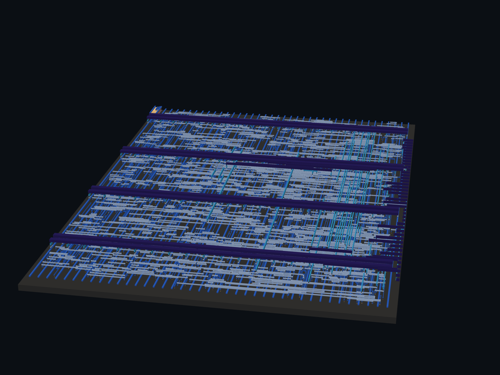
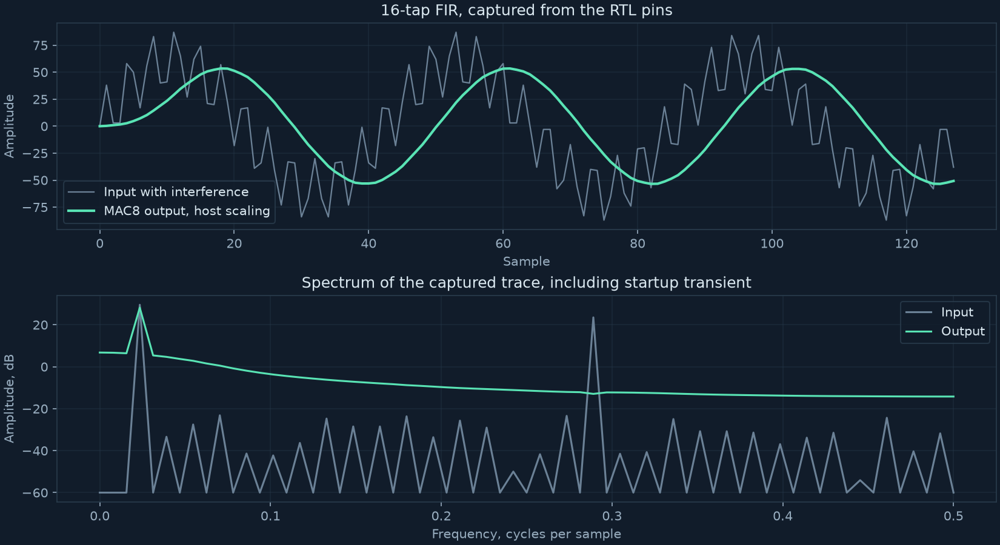
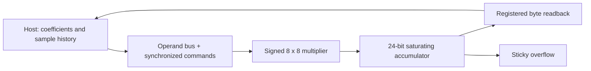

# MAC8

**An int8 multiply-accumulate unit for AI compute, designed from RTL to GDS on the SkyWater 130 nm process with open-source tools.**

[Interactive portfolio](https://arnav66692.github.io/mac8/reports/dsp-demo/) · [Design spec](docs/SPEC.md) · [Verification matrix](docs/VERIFICATION_MATRIX.md) · [Optimization study](docs/OPTIMIZATION.md)



## Overview

MAC8 multiplies two 8-bit signed numbers and adds the result into a 24-bit signed accumulator, with saturation and a sticky overflow flag. A multiply-accumulate is the basic operation inside every neural network, and MAC8 is a complete, verified version of it that fits in one Tiny Tapeout tile.

- **Design:** one multiplier, one accumulator and one command decoder in SystemVerilog, driven over an 8-bit operand bus with synchronized commands.
- **Flow:** RTL to GDS through the Tiny Tapeout flow on sky130, using cocotb, Icarus, Verilator, Yosys and LibreLane.
- **Application:** runs a host-controlled 16-tap INT8 FIR filter through the real pin interface.

## Results

| Area | Result | Scope |
|---|---:|---|
| Signed multiplication | All 65,536 operand pairs correct | RTL datapath simulation |
| Command soak | 100,000 operations per variant | Deterministic seeds, saturation and recovery |
| FIR filter | 128 outputs, zero integer mismatches | RTL and gate-level netlist |
| Physical design | 1,188 cells, DRC, LVS and antenna all 0 | Hardened layout, one tile |
| Timing | +1.556 ns setup at 50 MHz, hold met at all nine corners | OpenSTA |
| Tiny Tapeout prechecks | 15 of 15 passing | CI |
| Formal | Handshake proven unbounded, BMC 60, induction at step 30 | yosys-smtbmc with z3 |
| Optimization | Fused load and MAC: 364 to 252 cycles per output, +1.48% area | Routed comparison |





## Status

The design is hardened to GDS and passes all Tiny Tapeout prechecks. It has not been fabricated. The fused-MAC version in `experiments/fused/` is an experimental variant with its own module name and opcode contract, kept separate from the baseline.

AI helped implement and write the code to increase productivity.

## Build provenance

The historical physical-design numbers here cite one netlist and its sha256.
The waiver, the datasheet, and this README describe that sealed package from
outside it, they are documentation, not new state.

| Seal | Value |
|---|---|
| Final hardened run | CI 29401092054 |
| Commit | 49f5f298692f274c6613cdc940e0cee991281943 |
| Raw reports | [Hash manifest](reports/sealed/29401092054/manifest.json), [successful CI run](https://github.com/Arnav66692/mac8/actions/runs/29401092054) |
| Netlist sha256, the one hash | 5d41493182cd1ece30f2f4a2bdabdf5433400f7b508858161ea6f72db4f13fb0 |

## Physical design details

| Number | Value |
|---|---|
| Standard cells | 1188, one tile, 64 percent utilization |
| Die and core area | 17954.7 and 16493.3 um2, the fixed 1x1 tile |
| Setup, worst corner max_ss_100C_1v60 | plus 1.556 ns at 50 MHz, TNS 0 |
| Hold, worst corner min_ff_n40C_1v95 | plus 0.111 ns, net of 0.25 ns clock uncertainty and 5 percent derate, TNS 0, all nine corners met |
| DRC, LVS, antenna | 0, 0, 0 |
| Tests | 9 datapath plus 14 protocol white box RTL, 14 pin only gate level, all green |
| Formal | handshake proven unbounded, yosys smtbmc with z3, BMC 60, induction closes at step 30, mutation gated, formal/README.md |
| Metastability MTBF bound | Conditional estimate using the extraction assumptions in [CDC_MTBF.md](docs/CDC_MTBF.md), not a measured silicon failure rate |

## Timing waivers

One waiver, W1, two classes of the same max transition finding,
docs/WAIVERS.md.

- Class 1, datapath fanout. Input slew past the 0.75 ns library limit on
  operand and multiplier high fanout nets, worst 1.207 ns at
  max_ss_100C_1v60. It clears on slack. The worst setup path runs through
  these nets and holds plus 1.556 ns. Charge the full extrapolation excess
  along the whole path and it still holds plus 0.46 ns, 1.41x inside.
- Class 2, reset tree. One branch of the synchronized reset fanout, net42,
  0.899 ns at max_ss. It transitions once per reset, not per cycle, and the
  reset release paths are met at every corner.

Max cap is clean at all nine corners. The Tiny Tapeout precheck does not
gate on max transition and read 15 of 15 green.

## Pin map

Interface spec, docs/SPEC.md, frozen, the version lives inside the file.
Clock 50 MHz nominal.

| Pin | Dir | Role |
|---|---|---|
| ui_in[7:0] | in | Operand bus |
| uio[2:0] | in | Command |
| uio[3] | in | Strobe, async, synchronized inside |
| uio[4] | out | Busy |
| uio[5] | out | Overflow flag, sticky |
| uio[7:6] | out | Reserved, driven 0 |
| uo_out[7:0] | out | Selected accumulator byte, registered |

Commands, 000 NOP, 001 CLR, 010 LDA, 011 LDB, 100 MAC, 101 SEL_LO,
110 SEL_MID, 111 SEL_HI. One command per strobe rise. Driver rules and
timing requirements are in the spec, each interface requirement has a
pinning test that runs on the hardened netlist.

## Layout

```
src/     four design modules plus the Tiny Tapeout top and hardening config
tb/      white box RTL suites, golden model, local only
test/    pin only suite, runs at RTL and on the hardened netlist in CI
docs/    SPEC.md the frozen contract, CDC_MTBF.md the metastability bound,
         HOLD_REPORT.md, GL_TIMING.md, FANOUT_FF1.md, WAIVERS.md,
         info.md the shuttle datasheet, cdc/ the extraction bench and sweeps
formal/  the mutation gated handshake proof, README, harness, gate script
```

## Reproduce the application

```sh
python -m unittest app.test_reference -v
make -C verification -f arithmetic.mk
make -C verification VARIANT=baseline
make -C verification VARIANT=fused
python scripts/check_app_mutations.py
python scripts/check_fused_control.py
```

The application suites each include the full 100,000-operation soak.
[Verification matrix](docs/VERIFICATION_MATRIX.md) records the requirements,
seeds, proof assumptions and remaining hardware measurements. Local report
rendering requires numpy, matplotlib, a SKY130 Liberty synthesis run and the
archived reports, see [OPTIMIZATION.md](docs/OPTIMIZATION.md).

## How to test the baseline

Run from the repo root. Install Icarus and Verilator on your PATH before these commands.

```
# one time venv, outside the repo, cocotb 2.0.1 needs Python 3.13 or lower
python3.12 -m venv ~/.venvs/mac8
source ~/.venvs/mac8/bin/activate
pip install -r test/requirements.txt

# white box RTL suites
make -C tb TB=datapath
make -C tb TB=top

# pin only suite at RTL, the same suite CI runs on the netlist
make -C test

# lint
verilator --lint-only -Wall --top-module tt_um_arnav_mac8 \
  src/mac8_*.sv src/tt_um_arnav_mac8.sv
```

CI runs the Tiny Tapeout GDS action, the shuttle precheck, and the gate
level suite on every push.

## How to run the proof

```
brew install yosys z3

# the acceptance test, it builds the proof, base passes and every mutation
# that removes a real protection is caught
bash formal/mutation_test.sh 60
```

The full BMC and unbounded induction recipe, the four properties, and the
mutation table are in formal/README.md.

## Verification approach

Adversarial review with mutation testing is the primary gate, and it caught
what the green suites could not. An exact rail saturation gap, a reset
phantom command, an arm bit reading the metastable flop, a lockout width
that ate a legal command at an alignment no deterministic simulation can
produce, and a reset pin the harness never promised to synchronize. Each
fix is pinned by a test where a test can see it, and by a written proof
where one cannot. The handshake proof itself passed vacuously twice before
it was real. Both audits and the mutation gate that closed them are in
formal/README.md.

## Deep docs

- docs/SPEC.md, the frozen interface contract, the version lives inside the file.
- formal/README.md, the mutation gated handshake proof and the two vacuity audits.
- docs/CDC_MTBF.md, the metastability extraction and the MTBF bound.
- docs/HOLD_REPORT.md, per corner hold.
- docs/GL_TIMING.md, the annotated gate level timing.
- docs/FANOUT_FF1.md, the ff1 fanout evidence.
- docs/WAIVERS.md, the one waiver and its two classes.
- docs/info.md, the shuttle datasheet.
